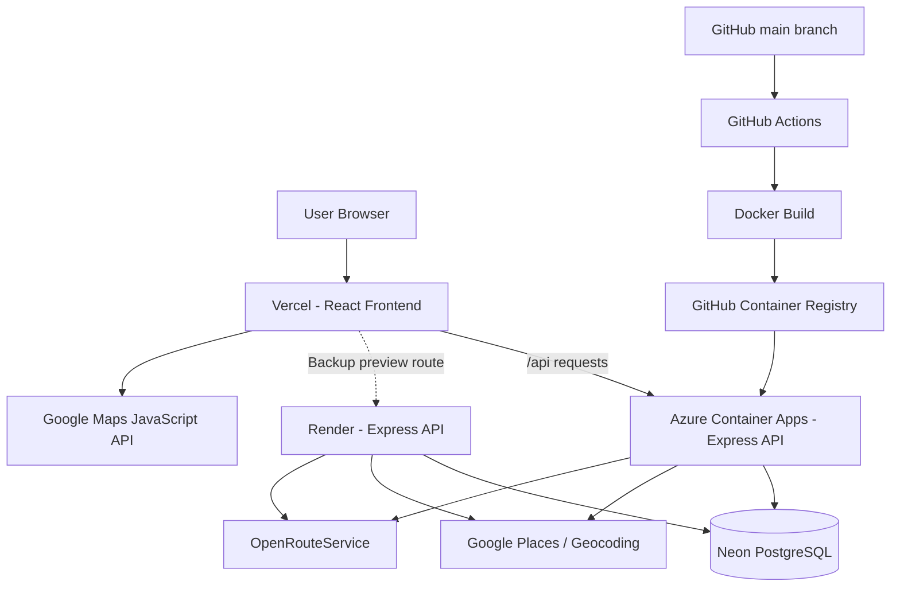

<div align="center">

# 🏠 PGPilot
### Commute-Aware PG Discovery with Explainable Smart Match Ranking

**Find accommodation that fits your commute, preferences, and everyday needs.**

[](https://react.dev/) [](https://nodejs.org/) [](https://neon.tech/) [](https://azure.microsoft.com/products/container-apps/) [](https://www.docker.com/) [](https://github.com/features/actions)

[**Live Application**](https://pg-pilot.vercel.app/) · [**Render Backup Preview**](https://pg-pilot-git-render-backup-test-aaquil-16.vercel.app/) · [**Repository**](https://github.com/AAQUIL-16/PGPilot)

</div>

> **Live URL note:** Confirm the production Vercel URL above before publishing this README. The Render preview URL is a test deployment, not the production website.

---

## Overview

**PGPilot** is a full-stack web application that helps students and other accommodation seekers discover nearby paying guest (PG) properties based on a chosen destination. Instead of relying only on straight-line proximity or a single rating, PGPilot combines **real place discovery**, **route-aware commute information**, and an **explainable Smart Match ranking** to support better accommodation decisions.

The application uses Google Places to discover real listings, Google Maps for visualization, OpenRouteService for travel estimates, and a PostgreSQL database hosted on Neon for application-owned user data. The React frontend runs on Vercel; the containerized Express API runs primarily on Azure Container Apps, with a separately tested Render deployment as a fallback option.

## Highlights

- **Real PG discovery:** Search accommodation around a user-selected destination using Google Places data rather than a static list of demonstration properties.
- **Interactive map:** Explore search results geographically using Google Maps.
- **Commute-aware search:** Estimate travel distance and time using OpenRouteService, including supported driving, walking, and cycling modes.
- **Explainable Smart Match:** Rank results using commute factors, Google ratings, and user-adjustable preference weights.
- **Search and compare:** Filter results, save favorites, and compare PG options.
- **Accounts and history:** JWT-based authentication, user profiles, search history, and feedback backed by PostgreSQL.
- **Cloud-native delivery:** Docker image builds published to GitHub Container Registry and deployed automatically to Azure via GitHub Actions.
- **Fallback deployment:** Separate Vercel preview connected to a Render-hosted backend for backup testing.

## Screenshots

Add screenshots from the actual application under `assets/screenshots/` and replace the placeholders below.

| Home / Destination Search | PG Results & Map |
|:---:|:---:|
| _Add `assets/screenshots/home.png`_ | _Add `assets/screenshots/results-map.png`_ |

| Smart Match / Comparison | Favorites / Profile |
|:---:|:---:|
| _Add `assets/screenshots/comparison.png`_ | _Add `assets/screenshots/favorites.png`_ |

## System Architecture



**Production request path:** Vercel forwards `/api/*` requests to the Azure backend through `vercel.json`. The Render preview branch uses a separate rewrite to Render. This is a **manual fallback option**, not automatic failover.

## Technology Stack

| Layer | Technologies |
|---|---|
| Frontend | React.js, Vite, Tailwind CSS |
| Backend | Node.js, Express.js, REST APIs |
| Database | PostgreSQL hosted on Neon |
| Authentication | JWT |
| Places and mapping | Google Places API, Google Maps JavaScript API |
| Routing | OpenRouteService API |
| Frontend hosting | Vercel |
| Primary backend hosting | Microsoft Azure Container Apps |
| Backup backend hosting | Render |
| Containerization | Docker, GitHub Container Registry (GHCR) |
| CI/CD | GitHub Actions, Azure federated identity (OIDC) |

## How Smart Match Works

PGPilot helps users evaluate results using more than a single popularity score:

1. **Discover** real PG listings near a destination.
2. **Estimate** commute distance and travel time along supported routes.
3. **Consider** available place ratings and user preferences.
4. **Rank** options using adjustable weights and expose the factors behind the recommendation.
5. **Compare and save** suitable results for later review.

> Smart Match is a preference-based recommendation mechanism, not a guarantee of accommodation quality or availability. External ratings and place details belong to their respective data providers.

## Deployment and CI/CD

The backend is packaged as a Docker image and published to GitHub Container Registry. On qualifying pushes to `main`, GitHub Actions builds a new image, tags it with the commit SHA, authenticates to Azure using a federated identity, and updates the Azure Container App.

```text
Push backend changes to main
          ↓
GitHub Actions workflow
          ↓
Docker build + image push
          ↓
GHCR (commit-SHA image tag)
          ↓
Azure Container Apps update
          ↓
API health check
```

The Azure Container App uses HTTP autoscaling with **minimum replicas 0** and **maximum replicas 1** to reduce idle compute usage. This may introduce a cold start on the first request after inactivity.

The Render backend and Vercel preview branch provide an independently hosted API deployment for manual backup testing. Both backends still depend on shared services such as Neon and external APIs.

## Running Locally

### Prerequisites

- Node.js and npm
- A PostgreSQL database
- Google Places and Google Maps API credentials
- OpenRouteService API credentials

### 1. Clone the repository

```bash
git clone https://github.com/AAQUIL-16/PGPilot.git
cd PGPilot
```

### 2. Configure the backend

```bash
cd server
npm install
```

Create `server/.env` with the environment variables used by your deployment:

```dotenv
PORT=5000
NODE_ENV=development
DATABASE_URL=postgresql://YOUR_CONNECTION_STRING
JWT_SECRET=YOUR_LONG_RANDOM_SECRET
GOOGLE_PLACES_API_KEY=YOUR_SERVER_SIDE_KEY
OPENROUTESERVICE_API_KEY=YOUR_ORS_KEY
```

**Never commit `.env` files or real credentials.** Ensure your database schema is initialized using the repository's database setup/migration procedure before testing authenticated features.

Start the backend:

```bash
npm start
```

Check `http://localhost:5000/api/health`.

### 3. Configure and start the frontend

From the repository root:

```bash
npm install
npm run dev
```

Open the local URL printed by Vite. Configure the frontend's Maps JavaScript API key and local API proxy according to the project's existing frontend configuration. In Google Cloud Console, authorize the local development origin for the browser-facing Maps key.

> **Configuration note:** Check the current frontend environment variable names and scripts in the repository before copying settings between environments; server-side and browser-facing Google API keys should remain separate.

## API Examples

| Method | Endpoint | Purpose |
|---|---|---|
| `GET` | `/api/health` | API health check |
| `GET` | `/api/locations/geocode?destination=VIT%20Vellore` | Resolve a destination |
| `GET` | `/api/pgs/search?destination=...&latitude=...&longitude=...` | Search PGs (JWT required) |
| `GET` | `/api/commute?...` | Estimate route distance and time |
| `POST` | `/api/commute/matrix` | Calculate and rank multiple commutes |
| `GET` | `/api/pgs/photo?name=...` | Proxy a Google Places photo |

Additional API groups include authentication, favorites, profiles, statistics, feedback, and search history. Protected routes require a valid authentication token.

## Security and Reliability

- JWT-protected routes for account-specific features.
- Authentication rate limiting and HTTP security headers through Express middleware.
- Server-side API secrets stored as deployment environment variables/secrets.
- Separate browser-facing Google Maps key restrictions for authorized website origins.
- Commit-tagged container images for traceable deployments.
- Azure scale-to-zero for cost-conscious operation.
- Separate Render deployment and preview frontend for manual fallback testing.

**Current limitation:** The Azure and Render backends share some external dependencies. The fallback is not an automatic disaster-recovery system; database backups, monitoring, and periodic end-to-end tests are recommended before relying on it for critical demonstrations.

## Future Improvements

- Automated smoke tests for login, search, favorites, and map rendering.
- Deployment monitoring and alerts.
- Database backup and restore drills.
- A documented, one-click fallback/rollback procedure.
- More comprehensive PG owner information and verification workflows.

## Project Links

- **Source code:** https://github.com/AAQUIL-16/PGPilot
- **Production frontend:** https://pgpilot-finder.vercel.app/ 
- **Render backup preview:** https://pg-pilot-git-render-backup-test-aaquil-16.vercel.app/
- **Primary API health:** https://pgpilot-api.wonderfulocean-f778d0aa.centralindia.azurecontainerapps.io/api/health
- **Render API health:** https://pgpilot.onrender.com/api/health

---

<div align="center">

**Built to make PG discovery more informed, commute-aware, and transparent.**

</div>
